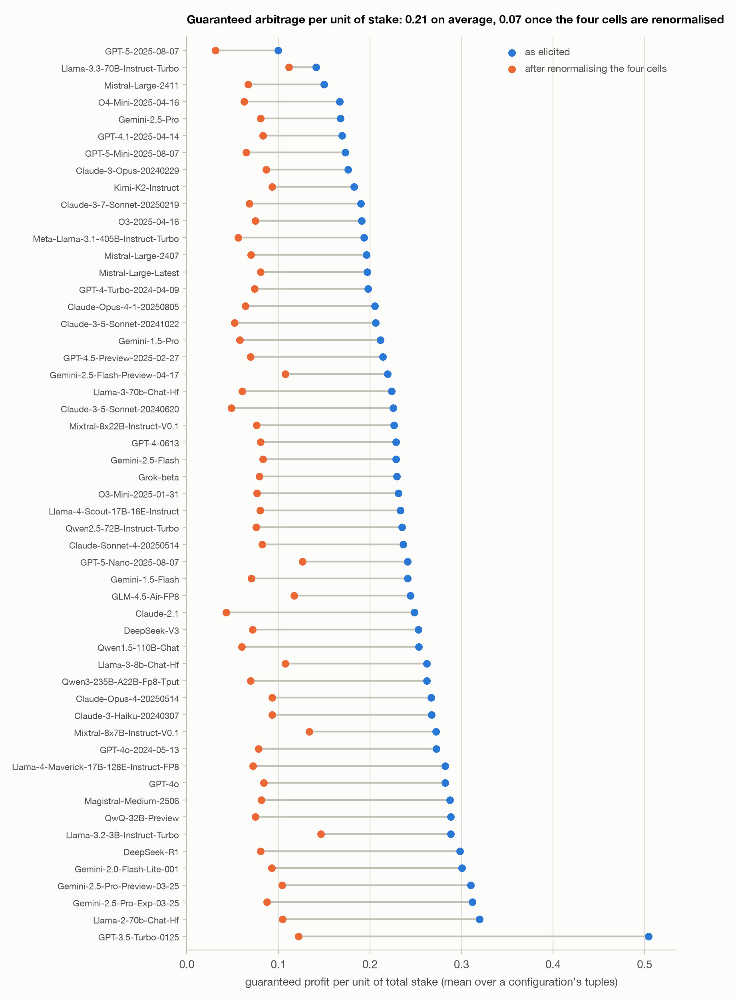
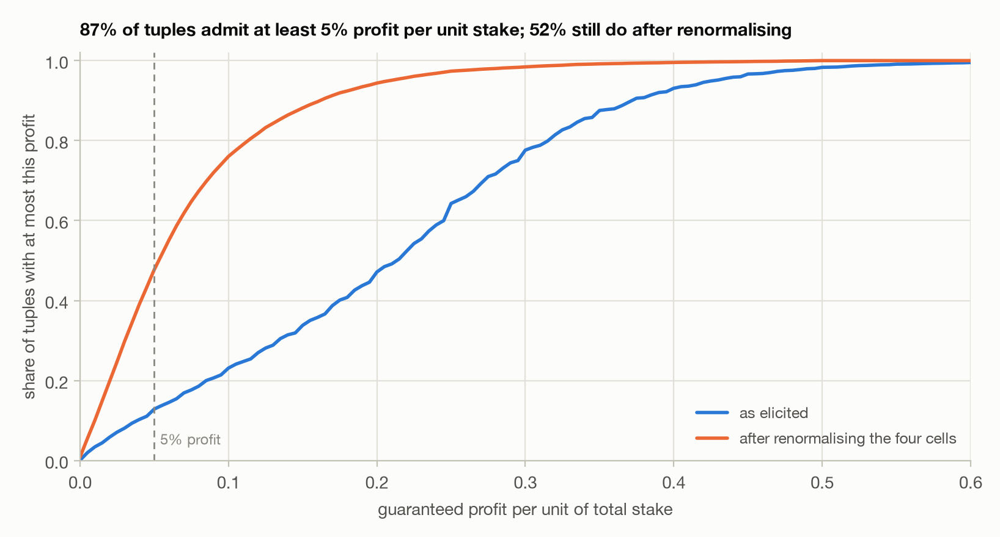
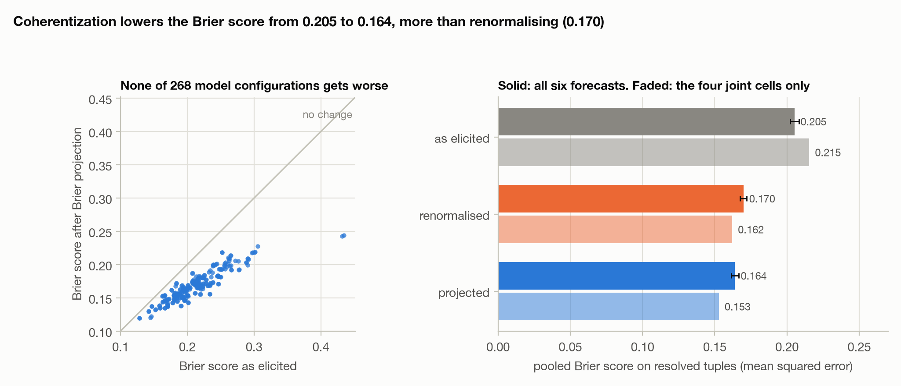
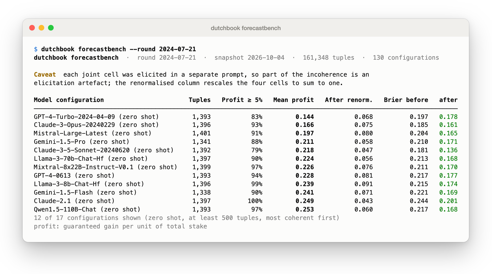
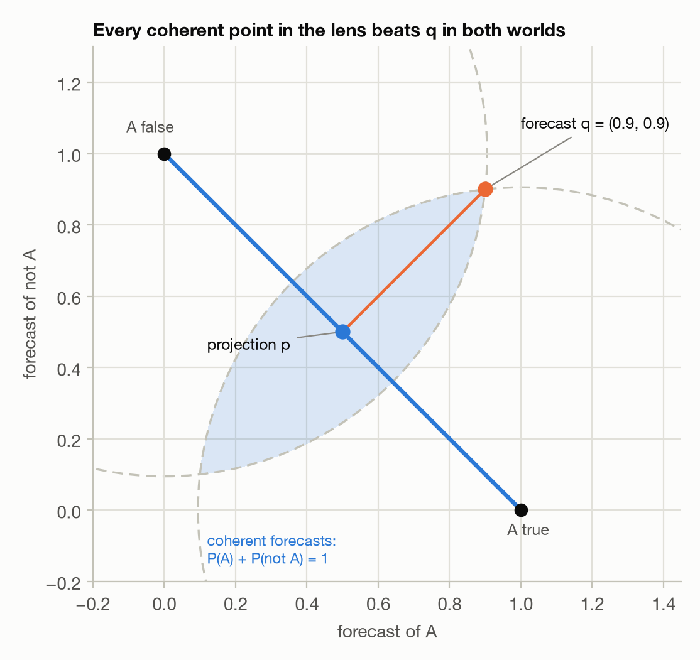
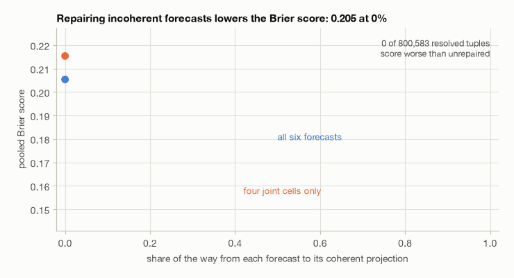
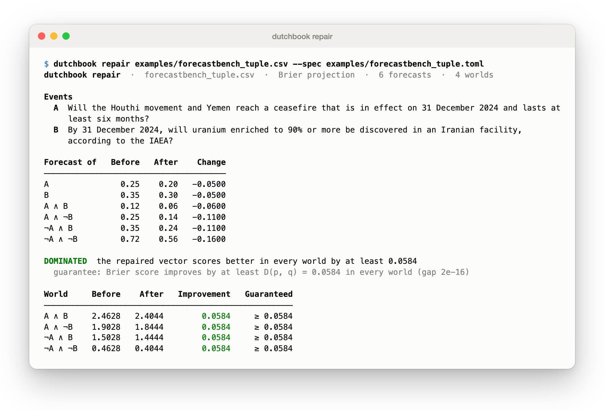
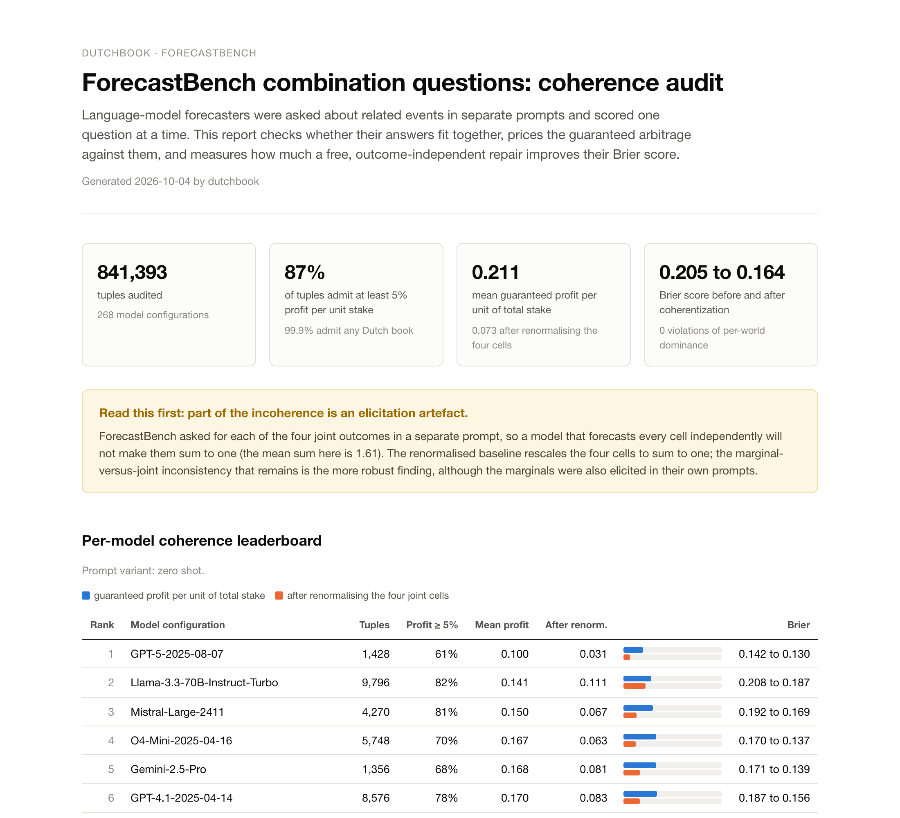

# dutchbook

Find the Dutch book in any set of probability forecasts over logically related events, price it exactly, and repair the forecasts so that no outcome's Brier score gets worse.

[](https://github.com/Thesimpleex/dutchbook/actions/workflows/ci.yml)




*A real ForecastBench tuple: a language model gave probabilities for two questions and for their four joint outcomes. The four joint outcomes sum to 1.44, so a bettor who sells all four contracts at the model's own prices collects 1.44 and pays 1 in every world.*

## Why this matters

Language-model forecasters are asked about related events in separate prompts and are scored one question at a time, so nobody checks whether the answers fit together. De Finetti showed that a set of probabilities is safe from a *Dutch book*, a collection of bets that loses money in every possible outcome, exactly when it is coherent, that is, when some probability measure over the possible worlds produces all of them. In finance terms a Dutch book is an arbitrage and coherence is the no-arbitrage condition. `dutchbook` is for evaluation researchers who audit forecasting benchmarks, forecasting teams that want to check a set of related forecasts before publishing, and students who want the Dutch book theorem and the accuracy-dominance theorem as executable code. It finds the book with linear programming, prices it exactly for a chosen stake norm, and projects the forecasts onto the coherent set, which provably lowers the Brier score in every outcome.

## Key results

The headline experiment audits the combination questions of [ForecastBench](https://www.forecastbench.org/) (Karger et al., ICLR 2025): pairs of binary questions $A,B$ for which language models gave the two marginals and the four joint cells. All numbers below are computed by `scripts/reproduce_all.py` on the snapshot pinned in [`docs/results.json`](docs/results.json): 841,393 tuples from 268 model configurations over 13 rounds (800,583 of them resolved), after dropping imputed forecasts and incomplete tuples.

> **Caveat, read first.** ForecastBench elicited each of the four joint cells in a *separate prompt* (the code that selected one of four prompts per cell is `combo_index` in `src/helpers/model_eval.py`; combination questions were removed in commits `83c0661` and `20ea01f`, issue [#149](https://github.com/forecastingresearch/forecastbench/issues/149), because they were not being scored). A model that forecasts every cell on its own will not make them sum to one, so part of the incoherence below is an elicitation artefact and not a property of what the model believes. The mean sum of the four cells is 1.61. The **renormalised baseline** rescales the four cells to sum to one and keeps the marginals; the marginal-versus-joint inconsistency that remains is the more robust finding. The marginals were also elicited in their own prompts, so even that is robust only to the sum-to-one artefact.

<picture>
  <source media="(prefers-color-scheme: dark)" srcset="docs/figures/incoherence-by-model-dark.png">
  
</picture>

*Mean guaranteed profit per unit of total stake (the sup-norm distance to the coherent polytope), one row per zero-shot configuration with at least 1,000 tuples, sorted by the value as elicited. Blue: as elicited; orange: after renormalising the four joint cells.*

- Pooled over all tuples the mean guaranteed arbitrage is **0.211** per unit of total stake (95% bootstrap interval over question pairs 0.209 to 0.214) as elicited and **0.073** (0.072 to 0.074) after renormalising: about two thirds of the arbitrage disappears once the cells are forced to sum to one.
- Forecasts are rounded, so nearly every tuple (99.93%) is formally incoherent. Counting only material arbitrage: 87.3% of tuples admit at least 5% profit per unit stake and 77.1% at least 10%. After renormalising, 52.4% (51.8% to 53.0%) still admit at least 5% and 24.1% at least 10%.
- Across the 53 zero-shot configurations with at least 1,000 tuples the mean arbitrage ranges from 0.100 (GPT-5-2025-08-07, one round) to 0.504 (GPT-3.5-Turbo-0125, one round), with a median of 0.231. Configurations differ in rounds and question mix, so the ranking is descriptive and not a controlled comparison.
- After renormalising, none of those configurations reaches zero: the renormalised mean arbitrage lies between 0.031 and 0.146 across those 53.

<picture>
  <source media="(prefers-color-scheme: dark)" srcset="docs/figures/arbitrage-distribution-dark.png">
  
</picture>

*Share of tuples with at most a given guaranteed profit. The dashed line marks 5% per unit of stake.*

<picture>
  <source media="(prefers-color-scheme: dark)" srcset="docs/figures/brier-before-after-dark.png">
  
</picture>

*Brier score on the 800,583 resolved tuples (mean squared error over the six forecasts).*

- Replacing every tuple by its Euclidean projection onto the coherent polytope lowers the pooled Brier score from **0.2054** to **0.1640** (gain 0.0414, interval 0.0406 to 0.0421). Renormalising only reaches 0.1699, and makes the whole vector worse in 25.4% of tuples; the projection makes it worse in none.
- **Dominance certificate: zero violations.** For every one of the 841,393 tuples and each of its four possible worlds, $\mathrm{Brier}(q,w)-\mathrm{Brier}(p^{\ast},w)\ge\|p^{\ast}-q\|^2$ holds up to $2\cdot10^{-15}$. The 0.08% of resolved tuples (623) whose score does not improve by more than $10^{-12}$ are coherent or lie within $2\cdot10^{-6}$ of the coherent set.
- The guarantee is for the vector as a whole. The Brier score of the four joint cells alone falls on average (0.2154 to 0.1529) but rises for 13.8% of tuples; see [methodology](docs/methodology.md) for a two-line example.

The same tuple-level audit is available from the command line, and as a self-contained report ([`docs/forecastbench-report.html`](docs/forecastbench-report.html)).

<picture>
  <source media="(prefers-color-scheme: dark)" srcset="docs/screenshots/leaderboard-dark.png">
  
</picture>

**Local versus global coherence.** The tuples of one model configuration, round and resolution date also form a graph: questions are nodes, pairs are edges. To isolate global effects, every pair table was first replaced by the closest joint table with the model's own marginals (so each pair is coherent and pairs agree on shared marginals), and the whole graph was then audited against one joint distribution over all its questions, by column generation for components above 10 atoms. For three zero-shot configurations (Claude-3-5-Sonnet-20240620, GPT-4o-2024-05-13, Llama-3.3-70B-Instruct-Turbo; 2,415 components with at most 30 questions, 461 larger components skipped for runtime), the **1,948 components that are trees admit no Dutch book at all**, as the theorem requires, while **37 of the 467 components with a cycle (7.9%)** do, with a guaranteed profit of up to 0.088 per unit of total stake. Local coherence therefore does not imply global coherence on real forecasts, but the effect is small next to the pairwise incoherence above.

## Philosophy: three theorems and one analogy

- **Dutch book theorem (de Finetti 1937).** If you are willing to buy or sell a one-unit bet on $\varphi$ at your price $q_\varphi$, you are exposed to a guaranteed loss exactly when your prices are not those of a probability measure. The proof is the separating hyperplane theorem.
- **Accuracy dominance (Joyce 1998; Predd et al. 2009).** There is a second, non-pragmatic route to the same conclusion: if your forecasts are incoherent there is a coherent forecast that is closer to the truth in every possible world, whatever the world is. The Euclidean projection is one such forecast.
- **Fundamental theorem of prevision (de Finetti 1974).** Coherent probabilities for some events constrain, without determining, the probability of others; the admissible values form an interval found by two linear programs.
- **Finance.** Replace "bets at a forecaster's prices" by "positions at quoted prices": the Dutch book is a static arbitrage, the coherent polytope is the no-arbitrage price set, and the profit per unit of total stake is the size of the arbitrage.

<picture>
  <source media="(prefers-color-scheme: dark)" srcset="docs/figures/geometry-of-dominance-dark.png">
  
</picture>

*Joyce's picture for $A$ and $\neg A$. The two vertices are the worlds, the blue segment is the coherent set, and the shaded lens is the set of forecasts closer than $q=(0.9,0.9)$ to both worlds. The projection $p=(0.5,0.5)$ lies in it.*

<picture>
  <source media="(prefers-color-scheme: dark)" srcset="docs/animations/repair-path-dark.gif">
  
</picture>

*Moving every forecast a fraction of the way to its projection: the pooled Brier score of the 800,583 resolved tuples falls along the whole path, and no tuple scores worse than unrepaired at any point.*

## Method

Let $W\in\{0,1\}^{k\times m}$ be the truth matrix of $m$ formulas in $k$ distinct worlds and $q\in[0,1]^m$ the forecasts. The coherent polytope is $C=\{W^\top\lambda:\lambda\in\Delta\}$.

**Coherence and the Dutch book.** A bettor with stakes $s$ earns $\pi_w(s)=\sum_j s_j(W_{wj}-q_j)$ in world $w$. By minimax duality, for a norm on the stakes with dual norm $\|\cdot\|_{\ast}$,

$$
\max_{\|s\|\le1}\ \min_w\ \pi_w(s)\;=\;\min_{p\in C}\ \|p-q\|_{\ast} .
$$

Total stake $\|s\|_1\le1$ gives the sup-norm distance to $C$ (the measure of Andrews and Sarkar, 2026), $\|s\|_\infty\le1$ the $\ell_1$ distance, and Euclidean stakes the $\ell_2$ distance. The stakes come from one LP over the distinct worlds (HiGHS) and are returned as explicit buy and sell orders at the forecaster's own prices, with the payoff in every world.

**Coherentization and the dominance certificate.** The projection $p^{\ast}=\arg\min_{p\in C}D(p,q)$ is computed for the Brier divergence $D=\|\cdot\|^2$ with Wolfe's min-norm-point algorithm and for the KL divergence (log score) with away-step Frank-Wolfe, both from a linear minimisation oracle and both stopping on the Frank-Wolfe duality gap. The score of a forecast in a world is the divergence from that world's truth vector, so the generalised Pythagorean inequality gives, for every world $w$,

$$
S(q,w)-S(p^{\ast},w)\;\ge\;D(p^{\ast},q).
$$

The certificate checks this margin in every world, with the duality gap as the only slack.

**Extension bounds, many atoms, conditionals.** The interval of coherent probabilities for a new formula is two LPs; for $P(A)=a$ and $P(A\wedge B)=a\,P(B\mid A)$ it is $[a\,P(B\mid A),\ a\,P(B\mid A)+1-a]$. Beyond 22 atoms, column generation prices the book with a MILP oracle over the atoms and subformulas and certifies the profit in all worlds by matching a lower and an upper bound. Conditional forecasts are checked through called-off bets with the sequence of LPs of Coletti and Scozzafava and of Gilio. Derivations are in [`docs/methodology.md`](docs/methodology.md).

## What is standard and what is new here

Standard, and not claimed as new: de Finetti's Dutch book theorem and fundamental theorem of prevision, LP duality, Wolfe's algorithm, Frank-Wolfe methods, the accuracy-dominance theorem of Joyce and of Predd et al., the sequence-of-LPs criterion for conditional coherence, and the sup-norm arbitrage measure of Andrews and Sarkar, which is the special case `stake_norm="l1"`.

What this repository adds is an open, tested implementation that is general (any propositional formulas, three stake norms, Brier and log projections, extension bounds, called-off bets, graphs of pairwise forecasts), exact (LP and duality-gap certificates, not heuristics), scalable beyond enumeration (column generation with a MILP oracle, cross-checked against enumeration), and corrective (the dominance certificate per world). The ForecastBench audit, the renormalisation baseline and the local-versus-global analysis of its question graphs are new empirical work built on it, subject to the limitations below. Related work on consistency checks for language-model forecasters: Paleka et al. (2024).

## Installation

```bash
git clone https://github.com/Thesimpleex/dutchbook
cd dutchbook
python -m venv .venv && source .venv/bin/activate
pip install -e .            # numpy, scipy, rich
pip install -e ".[dev,docs]"  # tests, plots, screenshots (the latter need Google Chrome)
```

Python 3.11 or newer.

## Quickstart

```python
import dutchbook as db

# The Linda problem: a conjunction priced above one of its conjuncts.
formulas = ["B", "F & B"]
q = [0.15, 0.35]
labels = ["bank teller", "feminist and bank teller"]

a = db.audit(formulas, q, labels=labels)
print(f"coherent: {a.coherent}, guaranteed profit per unit of total stake: {a.book.profit:.3f}")
for o in a.book.orders(q, labels):
    print(f"  {o.side:<4} {o.label:<26} at {o.price:.2f}, stake {o.stake:.2f}")

r = db.repair(formulas, q, labels=labels)
print("repaired forecasts:", r.repaired.round(3).tolist())
print(f"Brier score improves by at least {r.certificate.divergence:.3f} in every world")
print(f"worst-world improvement: {r.certificate.min_improvement:.3f}")

b = db.extension_bounds(["A", "A & B"], [0.7, 0.35], "B")
print(f"P(B) must lie in [{b.lower:.2f}, {b.upper:.2f}]")
```

```text
coherent: False, guaranteed profit per unit of total stake: 0.100
  BUY  bank teller                at 0.15, stake 0.50
  SELL feminist and bank teller   at 0.35, stake 0.50
repaired forecasts: [0.25, 0.25]
Brier score improves by at least 0.020 in every world
worst-world improvement: 0.020
P(B) must lie in [0.35, 0.65]
```

Formulas use `~`, `&`, `|`, `->`, `<->` (also `¬ ∧ ∨ → ↔` and the words `not and or implies iff`). Conditional events are written `"B given A"`; `db.check_conditional_coherence` and `db.find_conditional_dutch_book` take them. Formula sets over more than 16 atoms are handled by column generation automatically (`method="auto"`).

## Command line

```bash
dutchbook audit forecasts.csv --spec formulas.toml      # coherence, bets, payoff in every world
dutchbook repair forecasts.csv --spec formulas.toml --out repaired.csv --certificate cert.json
dutchbook bounds forecasts.csv --spec formulas.toml --formula "B"
dutchbook forecastbench --round 2024-07-21 --html report.html
```

`forecasts.csv` has the columns `id,forecast` and optionally `group` (one forecast set per group); `formulas.toml` maps ids to formulas and may describe the atoms:

```toml
title = "The Linda problem"

[atoms]
F = "Linda is active in the feminist movement"
B = "Linda is a bank teller"

[formulas]
feminist = "F"
bank_teller = "B"
feminist_bank_teller = "F & B"
```

`audit` exits with status 1 when it finds a Dutch book, 0 when the forecasts are coherent and 2 on bad input. `--stake-norm l1|linf|l2` selects the stake norm, `--stake 100` scales the stakes, `--html` and `--json` write a report and a machine-readable result. `repair --divergence kl` projects in the log score. `--method column-generation` prices the book with the MILP oracle instead of enumerating worlds (chosen automatically beyond 16 atoms). Runnable examples are in [`examples/`](examples): the Linda problem as a CSV audit, a real ForecastBench tuple, `frustrated_triangle.py` (pairwise-coherent but globally incoherent) and `conditional.py` (the chain rule as a Dutch book with a called-off bet).

<picture>
  <source media="(prefers-color-scheme: dark)" srcset="docs/screenshots/repair-dark.png">
  
</picture>

*`dutchbook repair` on the same tuple: every world improves by at least the divergence $D(p^{\ast},q)$.*

<picture>
  <source media="(prefers-color-scheme: dark)" srcset="docs/screenshots/report-overview-dark.png">
  
</picture>

*The self-contained HTML report ([`docs/forecastbench-report.html`](docs/forecastbench-report.html)): headline cards, the elicitation caveat, a per-model coherence leaderboard, figures and a worked Dutch book.*

## Reproducing the results

```bash
pip install -e ".[dev,docs]"
python scripts/reproduce_all.py          # downloads about 133 MB into data/raw/ (gitignored)
```

This downloads the ForecastBench snapshot, solves the exact LP and the projection for every tuple, and rewrites `docs/results.json`, the figures, the animations, the report and the screenshots. A cold run, download included, took about 10 minutes on a ten-core laptop (fewer cores take proportionally longer); results are cached under `data/cache/`. The run is deterministic given the snapshot: the results file records the snapshot's URL, ETag, size, SHA-256 and download date (2026-10-04), the last resolution date observed (2026-08-31), package versions and the seed of the bootstrap. A newer snapshot has later resolutions and will give slightly different numbers. Individual steps are in `scripts/` (`validation_experiments.py`, `forecastbench_experiment.py`, `pairwise_experiment.py`, `make_figures.py`, `make_animations.py`, `make_report.py`, `make_screenshots.py`).

The test suite (`pytest`, about 15 seconds, no network) covers the closed forms, the duality and Pythagorean invariants on random instances, the independent references listed in the methodology, and the data pipeline on a synthetic snapshot. `docs/results.json` also holds the validation extremes on 2,000 random instances (duality error at most $10^{-13}$, projection against exact support enumeration at most $2\cdot10^{-14}$).

## Limitations and next steps

- **Elicitation.** The central caveat above applies to every ForecastBench number; the renormalised baseline controls for one artefact only. A joint elicitation (all four cells in one prompt) would be needed to separate belief from protocol, and this repository does not run any model.
- **Coherence is not accuracy.** A forecaster who is confidently wrong but coherent has no Dutch book against it. Repair improves the score in every world, but a coherent forecast can still be poor.
- **Rounding and materiality.** Forecasts are rounded, so formal incoherence is almost universal. The thresholds of 1%, 5% and 10% per unit stake are conventions, not tests; 1.7% of raw and 5.5% of renormalised tuples lie below 0.005, the largest distance that rounding to two decimals can produce.
- **Dependence.** The same question pair is forecast by many configurations, in several rounds and at several horizons. Intervals are bootstrapped over pairs, but pooled means weight configurations by their number of tuples, and the leaderboard compares configurations that saw different rounds.
- **Model risk of the dominance claim.** The guarantee is about the Brier score of the whole vector for the chosen divergence. It does not say each forecast, or each sub-block, improves, and it does not say the repaired forecasts are calibrated.
- **Enumeration and MILP.** Enumeration is limited to 22 atoms; column generation scales with the pricing MILP, which can be slow for formula sets with deeply nested connectives. The certified bounds assume the MILP solver is exact: on one real question graph the HiGHS bundled with SciPy 1.18 returned a suboptimal vertex, flagged optimal, with presolve switched on, so the oracle runs with presolve off and the instance is kept as a regression test (`tests/data/milp_presolve_regression.json`). Conditional coherence needs tolerance choices (`tol`) when conditioning events have tiny probability.
- **Not included.** Prediction-market adapters (terms of service to check first), elicitation of models through any API, MaxSAT backends.

## Data and licence

Code: MIT. ForecastBench processed forecast sets and question sets: Karger et al., [forecastbench.org](https://www.forecastbench.org/) and [github.com/forecastingresearch/forecastbench-datasets](https://github.com/forecastingresearch/forecastbench-datasets), licensed [CC BY-SA 4.0](https://creativecommons.org/licenses/by-sa/4.0/). The data are downloaded at run time into the gitignored `data/raw/` and are not part of this repository. The numbers in `docs/results.json`, the figures, the report and the example tuple under `examples/` (the question texts are quoted from the question set) are derived from that data and are shared under the same CC BY-SA 4.0 licence with attribution to the ForecastBench authors. Questions about real events appear only as forecasting examples, not as a statement about those events.

## References

- Andrews, I. and Sarkar, S. (2026). *Dutch Books for Language Models*. arXiv:2609.02797.
- de Finetti, B. (1937). La prévision: ses lois logiques, ses sources subjectives. *Annales de l'Institut Henri Poincaré* 7, 1-68.
- de Finetti, B. (1974). *Theory of Probability*, vol. 1. Wiley.
- Joyce, J. M. (1998). A nonpragmatic vindication of probabilism. *Philosophy of Science* 65(4), 575-603.
- Karger, E., Bastani, H., Yueh-Han, C., Jacobs, Z., Halawi, D., Zhang, F. and Tetlock, P. E. (2025). ForecastBench: A dynamic benchmark of AI forecasting capabilities. *International Conference on Learning Representations*.
- Paleka, D., Sudhir, A. P., Alvarez, A., Bhat, V., Shen, A., Wang, E. and Tramèr, F. (2024). *Consistency Checks for Language Model Forecasters*. arXiv:2412.18544.
- Predd, J. B., Seiringer, R., Lieb, E. H., Osherson, D. N., Poor, H. V. and Kulkarni, S. R. (2009). Probabilistic coherence and proper scoring rules. *IEEE Transactions on Information Theory* 55(10), 4786-4792.
- Wolfe, P. (1976). Finding the nearest point in a polytope. *Mathematical Programming* 11, 128-149.
